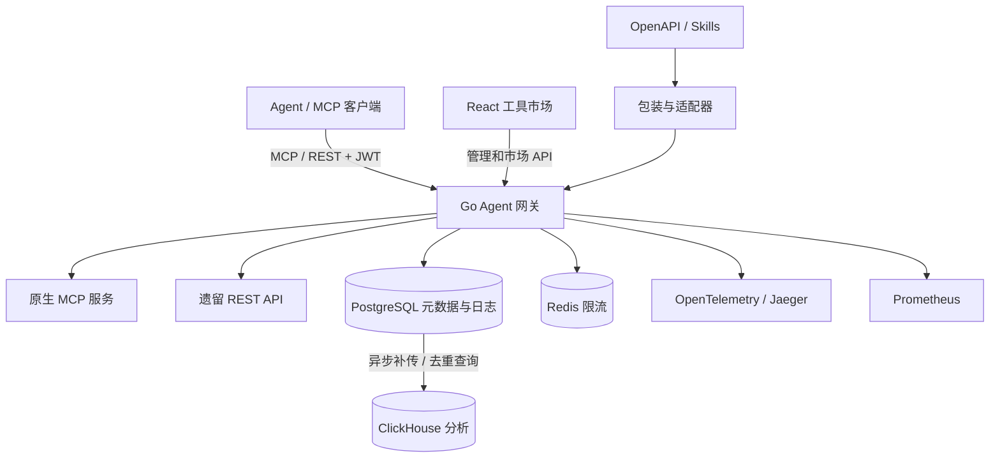

# 企业级 MCP 工具市场与智能体网关

统一发现、接入与调用 MCP 工具，将遗留 REST API 和 Agent Skills 纳入同一套网关治理流程。

本项目是软件工程实训选题 32 的可运行实现，包含 Go 网关、React 工具市场、OpenAPI 自动包装器、Skills 适配器，以及 Docker Compose 部署和真实服务验收记录。适合学习 MCP 集成、Agent 工具治理和平台工程。

## 核心功能

| 模块 | 已实现能力 |
| --- | --- |
| 工具市场 | 分类浏览、搜索、热度排序、详情、评分评论、版本历史、一键接入 |
| 注册中心 | MCP Server 注册、发现、工具同步、定时健康检查、上下线 SSE 通知 |
| Agent 网关 | MCP JSON-RPC 与 REST 调用入口、JWT、角色及用户级权限、Redis 令牌桶、工具熔断 |
| OpenAPI 包装 | OpenAPI 3.0/3.1 JSON/YAML 转 MCP 工具，参数序列化、请求体、安全方案、持久化绑定 |
| 代码生成 | 从 OpenAPI 生成独立可运行的 Go / TypeScript MCP Server 项目 |
| Agent Skills | 导入 JSON、SKILL.md 或 ZIP，校验 frontmatter 与包路径，按需读取资源，重启恢复 |
| 调用治理 | 参数摘要、批量调用与审计日志、成本估算、敏感工具高频告警、治理周报 |
| 日志分析 | PostgreSQL 日志异步同步至 ClickHouse，保存游标、断线补传、重放去重、故障回退 |
| 可观测 | OpenTelemetry 入口和下游调用追踪、Jaeger、Prometheus 指标 |
| 演示与验收 | 天气、文件、数据库 MCP 示例，真实数据库到报表工作流，权限与性能验收脚本 |

## 架构



熔断与短期元数据缓存位于网关进程内；权限覆盖每次从 PostgreSQL 查询。调用与审计日志批量保存，分析接口优先查询 ClickHouse，失败时回退 PostgreSQL。

## 技术栈

| 层次 | 技术 |
| --- | --- |
| 网关 | Go 1.26、Gin、pgx、go-redis、JWT |
| 前端 | React 19、TypeScript、Vite、Tailwind CSS |
| 数据 | PostgreSQL 16、Redis 7、ClickHouse 25.8 |
| 可观测 | OpenTelemetry、Jaeger、Prometheus |
| 示例服务 | Python 标准库；验收服务与压测客户端使用 Go |
| 部署 | Docker Compose v2 |

## 快速启动

需要已启动的 Docker Desktop（Linux 容器）或 Docker Engine + Compose v2。首次构建需要网络拉取镜像和依赖；仅运行 Docker 版本无需在本机安装 Go 或 Node.js。

### Windows（PowerShell）

```powershell
git clone https://github.com/bujue53/mcp-marketplace-gateway.git
cd mcp-marketplace-gateway
Copy-Item .env.example .env
docker compose up --build -d
docker compose ps
```

### Linux / macOS

```bash
git clone https://github.com/bujue53/mcp-marketplace-gateway.git
cd mcp-marketplace-gateway
cp .env.example .env
docker compose up --build -d
docker compose ps
```

`.env.example` 提供本机演示配置，`SEED_ON_STARTUP=true` 会注册示例工具。首次构建完成后等待网关日志出现 `gateway listening`，再打开市场页面。

| 入口 | 地址 |
| --- | --- |
| 工具市场 | http://localhost:5173 |
| 网关健康检查 | http://localhost:8080/health |
| MCP 端点 | http://localhost:8080/mcp |
| Jaeger | http://localhost:16686 |
| Prometheus | http://localhost:9090 |

演示账号：管理员 `admin / admin123`，开发者 `dev / dev123`。这些是公开的演示默认值。实际部署请先修改 `.env` 的密码和 JWT 密钥，并按[部署文档](docs/部署文档.md)配置访问范围。

### 第一次体验

1. 打开工具市场，浏览天气、文件、数据库等分类。
2. 登录后查看工具详情，提交评分评论，点击“一键接入”复制配置。
3. 使用 Python 3 客户端列出网关允许调用的工具：

```bash
python agents/mcp_client.py --list
python agents/mcp_client.py --mcp --tool weather_current --args '{"city":"东莞"}'
```

第二条命令适用于 Bash 或 PowerShell 7.3+。客户端自动登录，依次执行 MCP initialize、tools/list、tools/call。默认凭据被修改后，可用 `--user` 和 `--password` 指定账号。

4. 查看市场统计、Jaeger 调用链；接口请求示例见[接口使用说明](docs/接口使用说明.md)。

若使用空数据配置 `SEED_ON_STARTUP=false`，可手动注册演示工具：

```bash
docker compose exec gateway ./bin/ctl seed
```

## 验收结果

已完成 Docker 真实服务联调，包括 OpenAPI 包装、生成项目运行、追踪、Skills 重启恢复、ClickHouse 故障补传、权限撤销和报表工作流。详细记录保存在 `docs/`，原始机器结果为[最终三项验收结果](docs/最终三项验收结果.json)。

| 验收项 | 结果 |
| --- | --- |
| 无权限敏感调用 | 20/20 次拒绝，均保存审计；缓存预热后撤销权限立即生效 |
| 数据库到报表 | 读取真实 PostgreSQL 的 3 条演示订单，合计 700，保存 Markdown 后读回一致 |
| Skills | ZIP、frontmatter、按需资源读取、重启恢复通过 |
| ClickHouse | 离线时保留 PostgreSQL 日志，恢复后补传，重放后去重数量一致 |
| 压测成功率 | 42,000/42,000，100%，未发送或丢弃请求为 0 |
| 成功吞吐量 | 2,099.57 QPS |
| 网关开销 P99 | 2.0982 ms |
| 客户端端到端 P99 | 8.476939 ms |

压测环境为 Docker 16 CPU、约 7.37 GiB 内存，同网络 Go MCP 下游；2100 RPS 持续 20 秒、128 个工作线程、预热 100 次。验收将单用户额度设为 5000 RPS 并关闭逐请求控制台日志，JWT/RBAC、Redis、熔断、100% OTel 追踪、业务审计与计量均启用。默认业务额度为 20 RPS。网关开销扣除了下游 HTTP 至响应体读完的耗时；该结果仅适用于上述负载和测量窗口。完整口径见[性能验收报告](docs/性能验收报告.md)。

### 复验

需要本机 Node.js 22+。在项目根目录使用演示默认配置执行：

```bash
docker compose -f docker-compose.yml -f deploy/compose.acceptance.yml up --build -d gateway acceptance-backend
node tools/verify-final.mjs
```

脚本会创建验收账号、技能、订单表和报表，并暂时停止/恢复 ClickHouse、重启网关。脚本覆盖的功能及清理步骤见[Skills、ClickHouse 与性能验收](docs/三项功能实现与验收.md)。修改默认账号、数据库密码或 Compose 项目名后，需要同步调整验收配置；单元测试可在 `gateway/` 内执行 `go test ./...`。

## 仓库结构

```text
gateway/
  cmd/ctl/             网关、迁移、示例初始化入口
  cmd/acceptance/      验收 MCP 服务与固定速率压测客户端
  internal/api/        REST 与 MCP 路由
  internal/auth/       JWT 与权限判断
  internal/middleware/ 限流、熔断、审计、追踪
  internal/registry/   服务发现、同步、健康与状态事件
  internal/gateway/    工具调用路由
  internal/wrapper/    OpenAPI、Skills、Go/TS 项目模板
  internal/store/      数据持久化、缓存、批量日志、分析同步
  internal/otel/       OpenTelemetry 与下游 HTTP 追踪
  internal/metrics/    Prometheus 与调用计时
  migrations/          启动时自动执行的数据库迁移
web/                   React 工具市场
servers/               天气 REST 与原生 MCP 演示服务
specs/                 示例 OpenAPI 文档
agents/                Python MCP 客户端
deploy/                Prometheus 与验收 Compose 配置
tools/                 追踪、代码生成、综合验收及数据清理脚本
docs/                  设计、部署、兼容性与实际验收记录
```

## 文档导航

- [部署文档](docs/部署文档.md)：环境、配置、本地开发、启动停止和故障排查。
- [接口使用说明](docs/接口使用说明.md)：登录、工具调用、服务注册、包装与生成代码。
- [开发报告](docs/开发报告.md)：设计目标、模块划分、权限、限流、熔断与计量。
- [OpenAPI 兼容性与验证](docs/OpenAPI兼容性与验证.md)：支持范围和已验证场景。
- [骨架代码生成与验证](docs/骨架代码生成与验证.md)：生成项目结构和运行方式。
- [链路追踪验证](docs/链路追踪验证.md)：trace 传播、关联审计和联调记录。
- [Skills、ClickHouse 与性能验收](docs/三项功能实现与验收.md)：导入规范、分析同步和完整复验。
- [性能验收报告](docs/性能验收报告.md)：环境、实际数字和测量口径。
- [Agent 任务验收报表](docs/Agent任务验收报表.md)：合成订单的真实数据库工作流输出。
- [数据清理结果](docs/数据清理结果.json)：验收完成后的项目容器与数据卷清理记录。

## 运行数据与停止

仓库包含源代码、示例规范和验收记录。实际 `.env`、数据库卷、JWT、依赖目录及构建产物不上传。上一轮完整验收结束后，项目容器和数据卷已清理，运行服务已停止；新克隆的项目会按 `.env.example` 重新初始化演示数据。

```bash
# 停止，保留数据卷
docker compose down
```

清空当前项目运行数据请阅读[验收与清理说明](docs/三项功能实现与验收.md)；清理会删除数据库和报表卷。

## 当前边界

- 这是单网关实例的教学与演示实现；进程内熔断、状态事件和缓存尚未实现多实例一致性。
- OpenAPI 包装覆盖常见 3.x 场景，外部引用、OAuth2、二进制 multipart 等范围未实现，详见兼容性文档。
- Skills 作为说明与资源加载，包内脚本不会在网关执行；`allowed-tools` 由客户端理解，实际调用仍走网关权限。
- 报表 Agent 为规则驱动的 MCP 工作流，没有调用外部大模型；token 和成本采用字节估算，不是供应商真实账单。
- 日志队列正常退出会排空；强制结束进程或数据库不可用时，未提交的内存批次可能丢失。ClickHouse 分析有同步延迟。
- 演示市场/统计接口允许匿名读取；服务管理接口要求登录，一键接入为当前登录用户授予工具权限。面向不可信用户开放前，需要补充管理员审批、租户隔离和网络访问控制。

欢迎通过 Issues 提交复现信息或功能建议。仓库尚未指定开源许可证。
